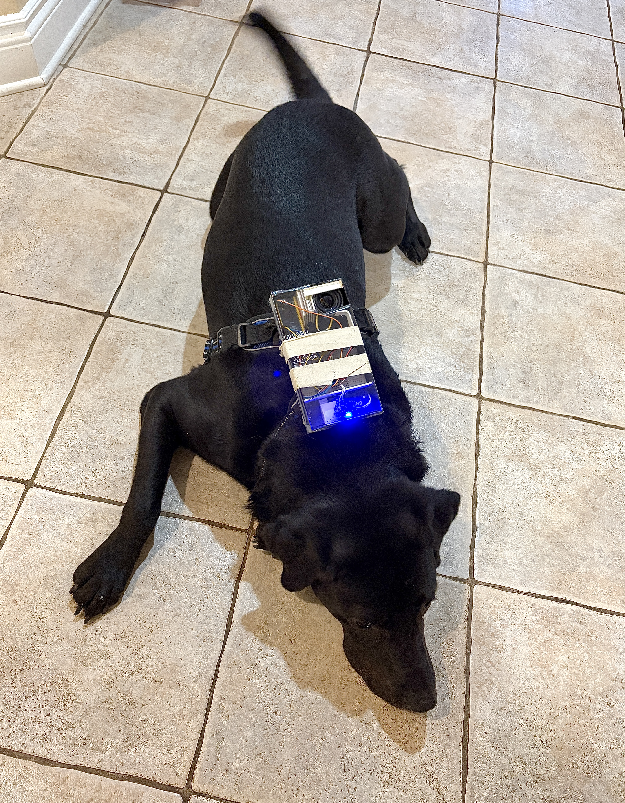
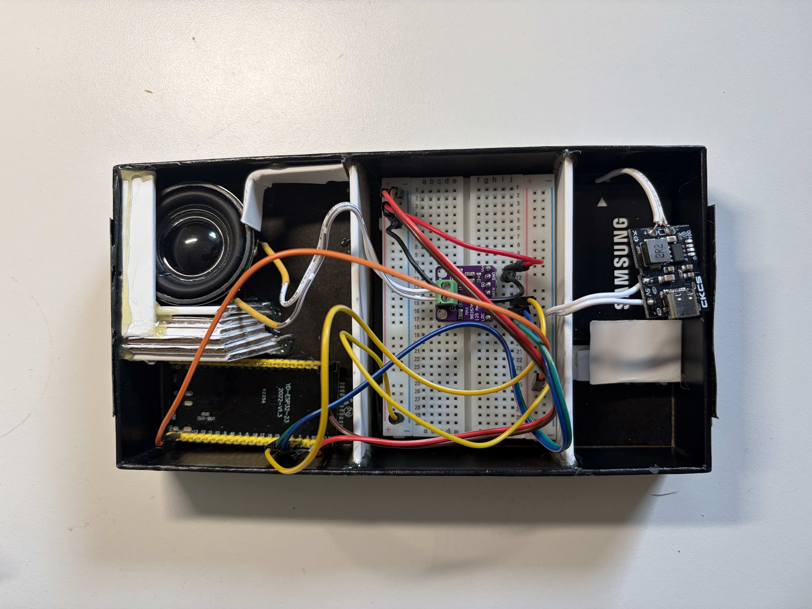
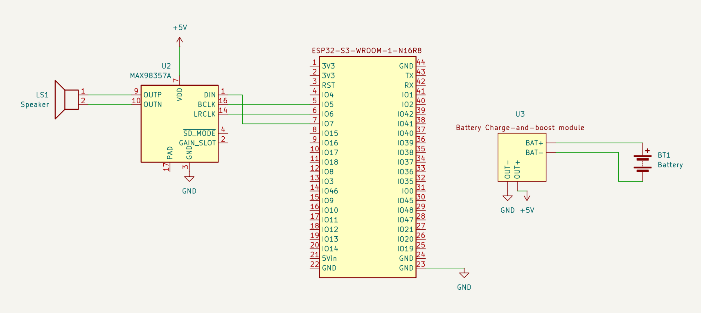

# Dog Communication Device

 &nbsp; &nbsp; 

## Intro
Oh, the guilt I feel when my dog is stuck inside! He lies by the screen door, gazing out at the backyard with wide, longing eyes... I’m building this project so he can hang out freely in our large backyard, even when everyone is busy.

So far, I’ve built a wearable device for dogs that play audio recordings to them from up to 100 meters away. Press a button on your phone, your dog hears the command and (if they’re smart enough), acts on it. It also has safety benefits, such as telling your dog to stand still if they are lost.

## How It Works

The firmware runs on ESP-IDF using separate FreeRTOS tasks:

- **Wi-Fi SoftAP:** the ESP32 creates its own Wi-Fi network that your phone connects to, and hosts the web page at `192.168.4.1`.
- **HTTP server:** serves the web page. Each button tap sends a clip request.
- **Queue:** the HTTP handler pushes the request into a FreeRTOS queue. Then, it returns immediately, keeping the web page responsive while audio plays.
- **Audio task:** waits on the queue for requests, looks up the embedded WAV, and streams the PCM samples over I2S to the amplifier.

## Wiring and Schematics


## Bill of Materials

| Part | Qty | Approx. cost (USD) | Purchase Link | Notes |
|---|---|---|---|---|
| ESP32-S3-DevKitC-1 | 1 | $10–15 | https://www.amazon.ca/dp/B0CKXJLP4B | 16 MB flash, 8 MB octal PSRAM. Clones like **N16R8** work fine |
| MAX98357A I2S amplifier breakout | 1 | $3–6 | https://www.amazon.ca/dp/B0F1LLQ6WJ | Class-D, 3 W into 4 Ω |
| 3 W 4 Ω speaker | 1 | $2–4 | https://www.amazon.ca/dp/B01LN8ONG4 ||
| Jumper wires / perfboard | – | – | |
| 3.7 V LiPo battery | 1 | $20 | https://www.amazon.ca/dp/B0F8MFGZZC | Interchangeable with other batteries |

## Project Structure

```
AudioPlayer+Wifi/
├── .gitignore
├── .vscode/                       # VSCode/PlatformIO settings
├── .pio/                          # build output, auto-generated
├── audio/                         # embedded WAV clips
│   ├── audio_1.wav
│   ├── audio_2.wav
│   ├── audio_3.wav
│   ├── audio_4.wav
│   ├── audio_5.wav
│   └── audio_6.wav
├── include/
├── lib/
├── managed_components/
│   └── joltwallet__littlefs/      # LittleFS component, downloaded automatically
├── src/
│   ├── CMakeLists.txt             # component registration and WAV embedding
│   └── main.c                     # Wi-Fi, HTTP server, and audio task
├── test/
├── CMakeLists.txt                 # top-level ESP-IDF project file
├── dependencies.lock
├── partitions.csv                 # custom partition table for 16 MB flash
├── platformio.ini                 # board overrides and embedded files
├── sdkconfig.defaults
└── sdkconfig.esp32-s3-devkitc-1   # generated ESP-IDF config
```

## Engineering Decisions

**Volume and hearing.** Dogs hear more sensitively than people do, and this device sits less than a meter from their ears. The firmware applies a software volume cap (`g_volume`) that scales samples before it reaches the amplifier. This way, even a loud recording can't play at full amplifier output. It's better to start quiet and turn it up than to accidentally startle (or hurt) the dog.

**Weight.** As a general guideline, wearables should stay well under ~5% of the dog's body weight. The current build weighs 130g.

**Chewing:** the battery and wiring will be enclosed so they can't be chewed or punctured. A punctured LiPo can catch fire.

**Why embedded instead of LittleFS?** Clips are compiled directly into the firmware with `embed_files` instead of being stored on a LittleFS partition, because PlatformIO's LittleFS image upload doesn't work with ESP-IDF on Windows. The trade-off is that changing clips requires a reflash, but with 16 MB of flash there's plenty of room.

**Eliminating amplifier buzz** The MAX98357A buzzes when the I2S peripheral is left running between clips. When no new samples arrive, the DMA buffers keep replaying the last bit of data that it received. The fix is to only enable the I2S channel when a clip starts, write a buffer of silence when the clip ends to avoid clipping, and disable the channel until the next clip. This keeps the speaker completely quiet when idle.

## Getting Started

### Prerequisites
- [VSCode](https://code.visualstudio.com/)
- [PlatformIO extension](https://platformio.org/install/ide?install=vscode)
- ESP-IDF 6.0.1 (PlatformIO installs it automatically through the `espressif32` platform)

### Installation

1. **Clone the repository**:
   ```bash
   git clone https://github.com/ethanluoeng/Dog_Communication_Device.git
   cd Dog_Communication_Device
   ```

2. **Record and add your own audio clips**
   - Use [Audacity](https://www.audacityteam.org/) or ffmpeg to convert your audio files to 16000Hz, 16-bit, mono .wav files.
   - Put the file in `audio/`.
   - Register it in **both** places:
      - `platformio.ini`, by adding it under `board_build.embed_files`
      - `src/CMakeLists.txt`, by adding it to `EMBED_FILES` in `idf_component_register(...)`
   - In `src/main.c`, declare the embedded symbols:

3. **Build & Flash on ESP32**:
   ```bash
   pio run                  
   pio run -t upload
   ```

### Usage
- Power on the device.
- On your phone, connect to the Wi-Fi network **`<SSID>`** (password: **`<password>`**). To change these, edit `<WIFI_SSID / WIFI_PASS>` in `src/main.c`.
- Open a browser and go to **http://192.168.4.1**.
- Tap a button to play that clip through the speaker.

## Documentation
`Daily_logs` contains the raw notes I took throughout the project, and `Organized_Project_Logs` contains those same logs organized in a logical manner.

- [Daily Logs](Documentation/Daily_logs.txt)
- [Organized Project Logs](Documentation/Organized_Project_Logs.pdf)

## Demo
<video src="Pictures/Demo.mp4" controls width="600"></video>
